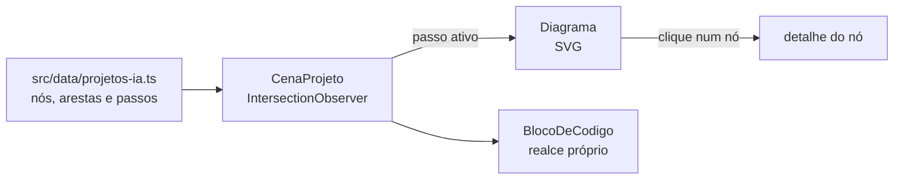

# Portfólio — Marcus Vinícius Vila Nova

Portfólio em que a arquitetura de cada projeto se monta na tela enquanto a página rola. Cada bloco do diagrama abre o que ele faz, e cada passo traz o trecho de código correspondente.

## Como funciona



- **Dados separados do desenho.** Cada projeto é uma lista de nós (com tipo: modelo, regra, dados, ferramenta), arestas e passos. Um passo revela nós e destaca o fluxo que está acontecendo.
- **Diagrama em SVG puro.** As curvas saem da borda de cada caixa (`geometria.ts`); arestas de retorno, como o verificador devolvendo ao redator, fazem um arco por fora. Os pacotes de dados correm pelas arestas ativas com `animateMotion`.
- **Rolagem que dirige o estado.** Um `IntersectionObserver` marca como ativo o passo que cruza a faixa logo abaixo do diagrama fixo.
- **Acessível.** Os nós são botões navegáveis por teclado. Com `prefers-reduced-motion`, nada anima e o exemplo da abertura não avança sozinho. Tema claro e escuro seguem o sistema.
- **Sem bibliotecas de UI.** Next.js, React e CSS Modules. O realce de sintaxe é uma função de 60 linhas.

Os trechos do projeto de RAG são cópias do [repositório público](https://github.com/marcusvilanova/rag-agentes-python). Os sistemas da Poiesis têm código privado: ali os trechos são reescritos para mostrar o padrão e aparecem marcados como ilustrativos.

## Stack

Next.js 16 · React 19 · TypeScript · CSS Modules · IBM Plex Sans e Plex Mono · Vercel

## Como rodar

```bash
npm install
npm run dev
```

`npm run build` gera a versão de produção. A página é estática.
